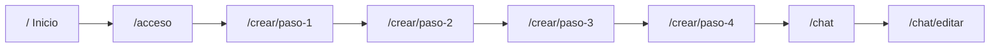

# eJoi Web

Cliente web de escritorio de eJoi. Usa el mismo backend que la app móvil (`eJoi-BE` y `eJoi-BE-Image`); no hay BFF ni base de datos propia.

## Requisitos

- Node.js 22 LTS (ver `.nvmrc`)

## Comandos

| Comando | Descripción |
| --- | --- |
| `npm run dev` | Servidor de desarrollo (Vite) |
| `npm run build` | Typecheck + build de producción |
| `npm run build:demo` | Build modo demo (`VITE_MOCK_API=true`) en `dist-demo/` |
| `npm run preview` | Vista previa del build |
| `npm run shots` | Capturas Playwright 1440/1280/1024 × claro/oscuro (requiere `build:demo`) |
| `node scripts/demo-timing.mjs` | Cronómetro demo Inicio → primer mensaje (requiere `build:demo`) |
| `npm run typecheck` | Solo TypeScript |
| `npm run lint` | ESLint |
| `npm run test` | Vitest (una pasada) |
| `npm run sync:app` | Copia módulos y assets desde `ejoiFE` (requiere `C:\ejoi\ejoiFE\ejoi` al lado) |
| `npm run sync:check` | Verifica manifiesto `SYNC.json` (CI, sin red) |
| `npm run verify` | sync:check + typecheck + lint + test + build |
| `npm run e2e` | Playwright (Chromium, Firefox, WebKit y Edge si está instalado) |

## Estructura (prevista)

- `src/` — código de la SPA
- `src/app-shared/` — módulos sincronizados desde `ejoiFE` (se añade en la tarjeta WEB-00b)
- `src/platform/` — shims de plataforma (HTTP, almacenamiento, env)
- **Ponytail** (lazy senior dev): `.cursor/rules/ponytail.mdc` (siempre activa), `.cursor/hooks.json` (modos `/ponytail`), skills en `.cursor/skills/`. Detalle en [`AGENTS.md`](AGENTS.md). Fuente: `../ejoiFE/ejoi/ponytail`.

## Sincronización con la app

Parte de la lógica (API clients, catálogos de onboarding, i18n base, tokens UX, tipos) vive en `ejoiFE` y se **copia generada** a `src/app-shared/` para no duplicar a mano ni diverger. El commit de origen queda en `src/app-shared/SYNC.json` (`ref`, `sha`, hash por archivo).

- **`npm run sync:app`**: lee archivos con `git show` desde `../ejoiFE/ejoi` (no hace checkout ni escribe en ejoiFE). Requiere `git fetch` en ese repo.
- **`npm run sync:check`**: comprueba que nadie editó `src/app-shared/` ni los assets listados en el manifiesto (sin acceder a ejoiFE).
- **No editar** archivos bajo `src/app-shared/`; cambios van en ejoiFE + nueva sincronización, o en shims bajo `src/platform/`.
- **Agregar un módulo**: añadir su ruta en `sync.config.json` → `entries` y volver a `sync:app`.
- **Cambiar versión de la app**: actualizar `ref` en `sync.config.json` (p. ej. `origin/develop`) y `sync:app`.

Los imports de plataforma (`HTTP`, almacenamiento, env) se resuelven a `src/platform/` vía alias (misma interfaz que la app).

## Variables de entorno

Copia `.env.example` a `.env.local` y ajusta según el entorno. En desarrollo, las peticiones a `/api` se proxyean al backend local (`VITE_DEV_API_PROXY_TARGET`).

### Modo mock (sin backend)

Con `VITE_MOCK_API=true` la SPA responde en el cliente con datos de demo (misma idea que el mock de Playwright). En `/acceso` aparece **Entrar en modo demo**. Desactiva la variable (`false` u omítela) y reinicia Vite/preview para usar eJoi-BE real.

Para capturas locales sin backend:

```powershell
npm run build:demo
npm run shots -- paso-1 chat-listo
# salida: docs/screens/<pantalla>-<claro|oscuro>-<ancho>.png
```

La hoja de componentes base vive en `src/theme/ui.css` (tokens en `src/theme/cssVars.ts`). `npm test` incluye `cssGuard.test.ts`, que falla si hay variables CSS inventadas o colores literales fuera de `src/theme/`.

## Revisión visual

Regenerar las 60 capturas de referencia (10 pantallas × claro/oscuro × 1440/1280/1024):

```powershell
cd C:\ejoi\EjoiWeb
npm run build:demo
npm run shots
# docs/screens/<pantalla>-<claro|oscuro>-<ancho>.png
```

Antes de commitear capturas nuevas, abrir cada PNG en claro y oscuro y comprobar:

- nada pegado al borde del viewport;
- nada cortado (texto, avatares, botones);
- la selección se distingue por borde, fondo y check;
- un solo botón primario destacado por pantalla;
- texto secundario más tenue que el principal;
- sin azul de enlace del navegador ni botones grises por defecto;
- en tema oscuro, sin sombras de elevación.

Los estilos computados se validan en e2e con `e2e/visual-tokens.spec.ts` (claro y oscuro).

```powershell
# .env.local
VITE_MOCK_API=true
npm run dev
# preview: la variable se embebe en el build
npm run build
npm run preview
```

## Flujo (Épica 11 / SCRUM-104)

Sin sesión, la web presenta el valor en **`/`** antes de pedir cuenta. La creación es un asistente único de **4 pasos** (mismo orden que el móvil v2); etnia y edad quedan en **Editar → Apariencia** con flags apagadas por defecto.



| Pantalla | Ruta | Notas |
| --- | --- | --- |
| Inicio | `/` | Hero + ejemplo de conversación; CTAs a acceso |
| Acceso | `/acceso` | Tarjeta centrada; demo en mock |
| Pasos 1–4 | `/crear/paso-N` | Una pregunta principal por pantalla |
| Chat | `/chat` | Perfil resumido; tema en Ajustes |
| Editar | `/chat/editar` | Apariencia (etnia/edad si flags activas) |

Galería revisable: `docs/screens/index.html` (`npm run build:demo` + `npm run shots`). Medición técnica para SCRUM-116: `node scripts/demo-timing.mjs` (desde **Crear mi eJoi** en `/` hasta el primer mensaje visible).

## QA e2e (SCRUM-116)

Por defecto las pruebas usan el build de preview en `127.0.0.1:4173` con API simulada (`page.route`) y login C4 (`POST /auth/test-session` mockeado).

### Entorno integrado 3.5 (opcional)

Requiere Docker y `eJoi-BE` local (plan Épica 11, §3.5): Postgres en `55432`, Redis en `56379`, `AUTH_TEST_SESSION_SECRET` en el backend, web en dev con proxy:

```powershell
# Backend (terminal 1) — ver SCRUM-104 plan §3.5 para .env.e2e
cd C:\ejoi\eJoi-BE
npm run start:dev

# Web (terminal 2)
cd C:\ejoi\EjoiWeb
# .env.local: VITE_DEV_API_PROXY_TARGET=http://localhost:4000, VITE_API_URL=/api
npm run dev
```

Con el dev server levantado:

```powershell
$env:PLAYWRIGHT_BASE_URL = 'http://127.0.0.1:5173'
$env:AUTH_TEST_SESSION_SECRET = '<mismo valor que el backend>'
npm run e2e
```

`eJoi-BE-Image` no es necesario: Playwright intercepta `**/image/**`.

Instalar navegadores (una vez): `npx playwright install chromium firefox webkit`. En Windows, Edge suele estar disponible; si no: `$env:PLAYWRIGHT_SKIP_EDGE = '1'`.

## Publicación

**No publicar** este sitio hasta que QA web (SCRUM-116) esté aprobada. `index.html` incluye `noindex` (DP-47).
